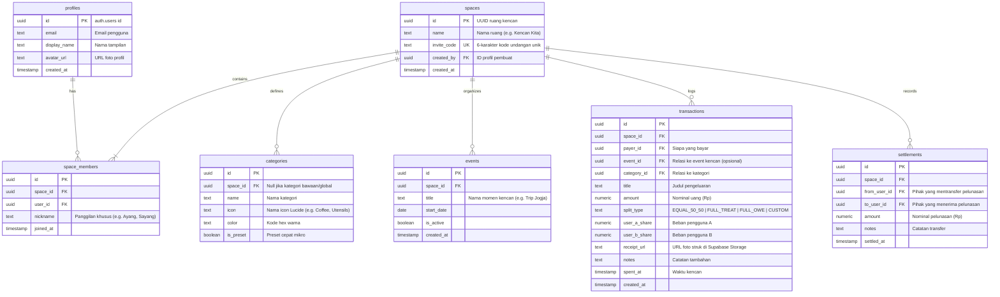

# Skema Basis Data & Keamanan (DATABASE.md)
> **Sistem Database**: PostgreSQL 15 (Supabase)  
> **Skrip SQL Siap Pakai**: [`supabase_schema.sql`](./supabase_schema.sql)

Dokumen ini menjelaskan rancangan skema database relasional, relasi antar tabel, aturan keamanan *Row Level Security* (RLS), trigger otomatis, dan konfigurasi bucket penyimpanan bukti transaksi untuk aplikasi **Kesflow**.

---

## 1. Diagram Relasi Entitas (ERD)

---

## 2. Rincian Tabel & Aturan Integritas Data

### 1. `profiles`
Menyimpan identitas publik pengguna. Otomatis dibuat melalui trigger saat akun baru terdaftar di `auth.users`.
- `id`: Primary key yang sama persis dengan `auth.users.id`.
- `email`: Alamat email pengguna.
- `display_name`: Nama pengguna (default diambil dari metadata nama Google/email).

### 2. `spaces`
Mewakili ruang kencan privat pasangan.
- `invite_code`: Kode 6 karakter alfanumerik huruf kapital unik (*case-insensitive*, contoh: `KISS88`). Digunakan oleh pasangan untuk bergabung ke dalam ruang yang sama.
- Dibatasi hanya untuk 2 orang melalui pengecekan di tingkat aplikasi dan constraint `space_members`.

### 3. `space_members`
Tabel penghubung relasi many-to-many antara `spaces` dan `profiles`.
- Memiliki constraint `UNIQUE(space_id, user_id)`.
- Jumlah baris dengan `space_id` yang sama dibatasi maksimal 2 anggota per ruang.

### 4. `categories`
Kategori pengeluaran kencan.
- Memiliki seed data bawaan:
  1. 🍽️ *Makanan & Minuman* (`UtensilsCrossed`)
  2. 🍿 *Camilan & Jajan* (`Cookie`)
  3. 🎬 *Nonton & Bioskop* (`Film`)
  4. 🛵 *Transport & Parkir* (`Car`)
  5. 🛍️ *Belanja Bareng* (`ShoppingBag`)
  6. 🏨 *Staycation & Liburan* (`Hotel`)
  7. 🎁 *Hadiah & Kejutan* (`Gift`)
  8. 💡 *Lain-lain* (`MoreHorizontal`)

### 5. `transactions`
Pencatatan setiap rupiah yang dikeluarkan saat kencan.
- `split_type`:
  - `EQUAL_50_50`: `user_a_share = amount / 2` dan `user_b_share = amount / 2`.
  - `FULL_TREAT`: Pihak pembayar menanggung 100%, pihak lain 0%.
  - `FULL_OWE`: Pihak yang dibayari menanggung 100% (penuh hutang).
  - `CUSTOM`: Pengguna menginput porsi nominal secara manual (total `user_a_share + user_b_share` harus sama dengan `amount`).

### 6. `settlements`
Mencatat pelunasan saldo berjalan.
- Setiap kali transaksi pelunasan dibuat, saldo berjalan (*running balance*) otomatis berkurang atau kembali ke Rp 0.

---

## 3. Keamanan Tingkat Baris (Row Level Security / RLS)

Semua tabel wajib mengaktifkan **Row Level Security (RLS)** untuk menjamin isolasi data total:
1. Pengguna hanya dapat membaca dan memanipulasi data yang berada di dalam `space_id` tempat mereka terdaftar sebagai member aktif.
2. Fungsi helper SQL `is_member_of_space(_space_id uuid)` digunakan pada seluruh kebijakan (*policies*) untuk verifikasi keanggotaan secara efisien.

---

## 4. Konfigurasi Cloud Storage (Struk Bukti Belanja)

Bucket penyimpanan:
- **Nama Bucket**: `receipts`
- **Tipe**: Privat (hanya dapat diakses oleh member space).
- **Kebijakan Akses Storage**:
  - `INSERT`: Pengguna yang terautentikasi dapat mengunggah file gambar (JPEG, PNG, WebP) dengan batasan ukuran maksimal 5MB.
  - `SELECT`: Anggota space dapat melihat pratinjau gambar struk.

---

## 5. Cara Menjalankan Migrasi di Supabase

1. Buka dashboard proyek Supabase Anda: [supabase.com/dashboard](https://supabase.com/dashboard).
2. Masuk ke menu **SQL Editor** pada navigasi samping.
3. Klik tombol **New query**.
4. Salin seluruh isi file [`supabase_schema.sql`](./supabase_schema.sql) dan tempelkan ke editor.
5. Tekan tombol **Run** (atau `Ctrl + Enter`).
6. Verifikasi bahwa semua tabel berhasil terbuat di menu **Table Editor**.
