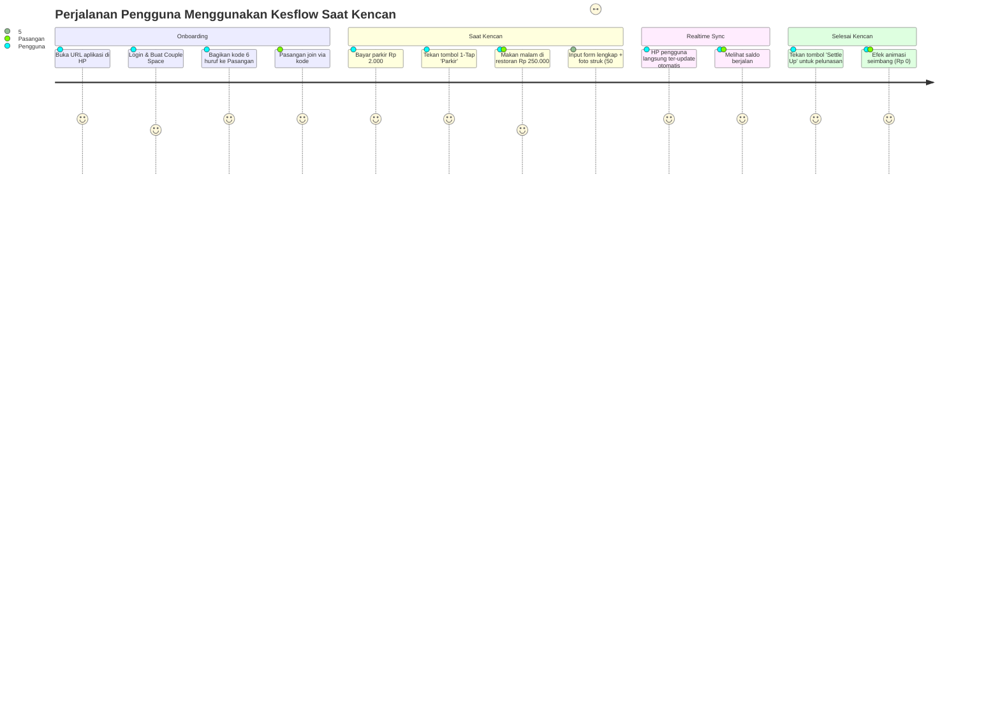

# Product Requirements Document (PRD) — Kesflow
> **Nama Produk**: Kesflow (Kencan Expense Flow)  
> **Kategori**: Couple Finance / Date Expense Tracker  
> **Target Rilis**: MVP V1  
> **Platform**: Progressive Web App (Mobile-First Web)

---

## 1. Latar Belakang & Pernyataan Masalah

### 1.1 Masalah Pengguna
Ketika pasangan sering bepergian bersama atau berkencan (*dating*), mereka menghadapi dilema keuangan harian:
1. **Pencatatan yang Rumit & Kaku**: Menggunakan aplikasi pencatat keuangan umum (*Money Lover, Wallet, Catatan Keuangan*) terlalu merepotkan karena mencampurkan pos pengeluaran pribadi dengan pos kencan berdua.
2. **Friksi Pengeluaran Mikro**: Pengeluaran-pengeluaran kecil seperti parkir motor Rp 2.000, parkir mobil Rp 5.000, atau beli air mineral sering terlewat karena membuka aplikasi dan mengetik form butuh terlalu banyak langkah (lebih dari 5 klik).
3. **Ketidakjelasan "Siapa Talangi Siapa"**: Pasangan sering bergantian membayar (kadang cowok menalangi makan malam, cewek membayar tiket bioskop). Tanpa pencatatan yang transparan dan seimbang, salah satu pihak sering merasa tidak enak hati atau bingung berapa saldo sisa yang harus dilunasi.
4. **Hambatan Ekosistem Lintas OS**: Pasangan sering menggunakan kombinasi perangkat yang berbeda (satu memakai iPhone/iOS, satu memakai Android). Membangun aplikasi native iOS memerlukan komputer Mac dan akun Apple Developer berbayar ($99/tahun), yang tidak praktis untuk kebutuhan personal berdua.

### 1.2 Nilai Utama Produk (Value Proposition)
Kesflow hadir sebagai **"Catatan Kencan Berdua yang Praktis, Romantis, dan Transparan"**:
- **PWA Bebas Biaya & Lintas Platform**: Dibangun sebagai website yang bisa diinstal seperti aplikasi native di iPhone dan Android secara gratis.
- **Ruang Privat Khusus Berdua**: Satu Couple Space yang hanya dihuni oleh 2 orang, terhubung melalui kode undangan sederhana.
- **1-Tap Micro Presets**: Mencatat uang parkir dan jajan dalam 1 detik.
- **Saldo Berjalan Ramah**: Tidak kaku seperti aplikasi tagihan hutang, melainkan bahasa yang santai dan ramah (*"Kamu ditalangi pacar Rp 45.000"*).
- **Momen Kencan Spesifik**: Mengelompokkan biaya berdasarkan momen (*e.g.* "Nonton Bioskop Weekend", "Trip Liburan Jogja").

---

## 2. Lingkup Produk (Product Scope)

### Dalam Lingkup (IN-SCOPE)
- Registrasi dan login akun masing-masing yang dipasangkan ke dalam 1 Couple Space privat.
- Pencatatan transaksi belanja kencan bersama (makan, nonton, transport, belanja bersama).
- Tombol *Quick-Tap Presets* untuk pengeluaran mikro bernominal kecil dan sering berulang (parkir, kopi, snack).
- Pilihan mode pembagian pengeluaran:
  - Bagi Rata (50:50).
  - 100% Ditraktir (tidak dihitung hutang, tapi masuk statistik total kencan).
  - Ditalangi Penuh (100% menjadi piutang pihak yang membayar).
  - Kustom Nominal.
- Saldo berjalan (*Running Balance*) real-time yang menunjukkan siapa yang sedang menalangi siapa.
- Fitur pelunasan saldo (*Settle Up*) untuk mereset saldo kembali ke Rp 0.
- Pengelompokan transaksi berdasarkan Acara/Trip Kencan (*Events*).
- Unggah foto struk belanja / bukti transfer (disimpan di cloud storage).
- Laporan & statistik kencan bulanan (kategori terboros dan perbandingan kontribusi bayar).

### Di Luar Lingkup (OUT-OF-SCOPE)
- Pengeluaran pribadi masing-masing yang tidak berhubungan dengan kencan.
- Rekening bank bersama atau integrasi Open Banking otomatis.
- Grup pengguna lebih dari 2 orang.
- Aplikasi native App Store / Google Play Store (fokus 100% pada PWA).

---

## 3. Alur Pengguna (User Journeys)

---

## 4. Kebutuhan Fungsional (Functional Requirements)

### FR-1: Couple Space & Autentikasi
- **FR-1.1**: Pengguna dapat masuk menggunakan Email / Magic Link atau PIN sederhana.
- **FR-1.2**: Setelah login, pengguna yang belum memiliki space akan diarahkan ke halaman onboarding untuk:
  - Membuat *Couple Space* baru (aplikasi menghasilkan 6-karakter kode acak unik, misal: `LOVE24`).
  - Atau bergabung ke *Couple Space* yang sudah ada dengan memasukkan kode undangan pasangan.
- **FR-1.3**: Satu *Couple Space* dibatasi ketat maksimal hanya **2 anggota**. Pengguna ketiga yang mencoba masuk akan ditolak.

### FR-2: Quick-Tap Presets (Pengeluaran Mikro)
- **FR-2.1**: Tersedia barisan tombol cepat di bagian atas beranda untuk mencatat pengeluaran kecil:
  - 🛵 Parkir Motor: Rp 2.000
  - 🚗 Parkir Mobil: Rp 5.000
  - 🏢 Parkir Mall: Rp 10.000
  - ☕ Kopi / Boba: Rp 25.000
  - 🍿 Camilan / Snack: Rp 20.000
- **FR-2.2**: Ketika tombol preset ditekan, muncul konfirmasi cepat (dialog bottom sheet) selama 1 detik dengan nilai bawaan: *Pembayar adalah akun yang sedang aktif*, *Pembagian 50:50*. Begitu dikonfirmasi, transaksi langsung tercatat.

### FR-3: Form Transaksi Reguler & Split Bill
- **FR-3.1**: Form pengeluaran menyediakan input:
  - Judul pengeluaran (contoh: "Sushi Tei Grand Indonesia").
  - Nominal (wajib > 0, otomatis diformat ke Rupiah `Rp xxx.xxx`).
  - Kategori (Makanan & Minuman, Nonton & Hiburan, Transport & Parkir, Belanja Bareng, Staycation, Lain-lain).
  - Pembayar (*Paid By*): Pengguna A atau Pengguna B.
  - Mode Pembagian (*Split Mode*):
    - **Bagi Rata (50:50)**: Masing-masing menanggung 50%.
    - **100% Ditraktir**: Pembayar menanggung 100% (tidak menambah hutang pihak lain, namun total pengeluaran tetap dicatat).
    - **Ditalangi Penuh**: Pembayar menanggung untuk pihak lain (seluruh 100% menjadi piutang).
    - **Kustom**: Input nominal beban masing-masing secara manual.
  - Tanggal & Waktu transaksi.
  - Lampiran foto struk / bukti pembayaran.
  - Tag Kencan Khusus (opsional).
  - Catatan tambahan (opsional).

### FR-4: Mesin Saldo Berjalan (*Running Balance*) & Settle Up
- **FR-4.1**: Sistem selalu menghitung selisih bersih (*net balance*) antara kedua pasangan secara otomatis.
- **FR-4.2**: Status saldo ditampilkan dengan ramah pada *BalanceCard*:
  - Contoh: *"Kamu ditalangi pacar Rp 35.000"* (jika posisi pengguna berhutang).
  - Contoh: *"Pacar berhutang ke kamu Rp 80.000"* (jika posisi pengguna menalangi).
  - Contoh: *"Saldo kalian seimbang (Rp 0)"* (jika posisi lunas).
- **FR-4.3**: Tersedia tombol **"Settle Up / Tandai Lunas"**. Ketika ditekan, sistem membuat catatan rekonsiliasi pembayaran pelunasan dan mengembalikan saldo berjalan menjadi Rp 0 tanpa menghapus riwayat transaksi belanja sebelumnya.

### FR-5: Pengelompokan Momen Kencan (*Events*)
- **FR-5.1**: Pengguna dapat membuat tag momen kencan (*e.g.* "Liburan Jogja", "Nonton Dune 2").
- **FR-5.2**: Pengguna dapat memfilter riwayat transaksi hanya untuk momen tersebut dan melihat total biaya kencan tersebut secara spesifik.

### FR-6: Unggah Foto Struk
- **FR-6.1**: Pengguna dapat mengambil foto dari kamera HP atau memilih dari galeri.
- **FR-6.2**: Gambar dikompresi di browser sisi klien sebelum dikirim ke cloud storage agar hemat kuota dan cepat.
- **FR-6.3**: Foto struk dapat dibuka dalam mode pratinjau layar penuh pada detail transaksi.

### FR-7: Statistik & Laporan Bulanan
- **FR-7.1**: Ringkasan total pengeluaran kencan bulan berjalan.
- **FR-7.2**: Diagram lingkaran (*Pie Chart*) distribusi kategori pengeluaran terboros.
- **FR-7.3**: Bar perbandingan kontribusi pengeluaran nyata antara Kamu dan Pasangan.

---

## 5. Kebutuhan Non-Fungsional (Non-Functional Requirements)

1. **Kecepatan Akses (Performance)**: First Contentful Paint (FCP) < 1.5 detik pada koneksi 4G mobile. Waktu pencatatan via Quick-Tap < 3 detik.
2. **Keamanan & Isolasi Data**: Menggunakan Supabase Row Level Security (RLS). Pengguna hanya bisa membaca dan mengubah data yang berada di dalam `space_id` mereka sendiri.
3. **PWA Standalone Compliance**:
   - Memenuhi standar Web App Manifest (display: standalone, portrait-primary).
   - Mendukung instalasi penuh di iOS Safari (*Add to Home Screen*) dan Android Chrome (*Install*).
   - Memiliki ikon aplikasi resolusi tinggi (192px dan 512px) serta Apple Touch Icon.
4. **Offline Resilience**: Saat koneksi internet terputus, aplikasi tetap dapat dibuka dan menampilkan cache data riwayat terakhir via Service Worker.
